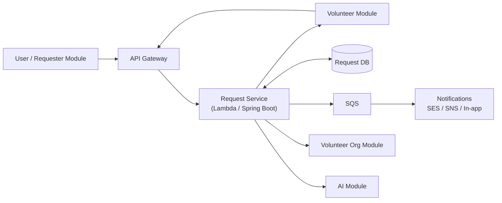

# Saayam For All - Request Service

## Overview
Saayam For All - Request Service is a Java/Spring Boot backend microservice that owns the **lifecycle of help requests** on the Saayam platform. A requester asks for help; this service registers the request, finds and notifies matching volunteers, tracks assignment and status through completion, and keeps requesters and volunteers informed.

The service runs both as a regular Spring Boot web application (REST controllers) and as **AWS Lambda functions** behind API Gateway.

> **Branch note:** this README is the same on `main`, `dev`, and `test`. Design documents live on `main`; application code and notification docs live on `dev` and `test`. Links below point to the branch that contains each file.

## Features
- **Request Management** - create, view, list (paginated), update, cancel, resume, and delete requests
- **Volunteer Assignment** - assign and remove volunteers on a request, including lead-volunteer handling
- **Help Categories & Metadata** - hierarchical help categories and per-category additional-info fields
- **Volunteer Matching** - in-person (proximity radius) and remote (help-category skill) matching
- **Sentiment-Gated Notifications** - lexicon-based sentiment check before notifying volunteers
- **Multi-Channel Notifications** - email (SES), SMS and push (SNS), and in-app, dispatched asynchronously via SQS
- **AWS Lambda Handlers** - API Gateway dispatcher and SQS consumer handlers
- **Global Exception Handling** - consistent `SaayamResponse` wrapper and error codes
- **Logging with AOP**
- **Internationalization** - 9 languages
- **Docker and Kubernetes Deployment Templates**

## Technologies Used
- **Spring Boot 3.3** (Java 17) - Backend framework
- **Maven** (wrapper included) - Build automation
- **PostgreSQL** + Spring Data JPA - Database
- **AWS Lambda, SQS, SNS, SES** - Serverless runtime and messaging
- **springdoc-openapi (Swagger UI)** - API documentation
- **Lombok** - Boilerplate reduction
- **Docker** - Containerization
- **Kubernetes (EKS)** - Deployment
- **JUnit 5 + Mockito** - Testing

## Architecture & Design Documents
The design documents describe the intended behavior of the service:

| Document | Branch | What it covers |
| --- | --- | --- |
| [Request Microservice Requirements](https://github.com/saayam-for-all/request/blob/main/docs/request-service-requirements.md) ([PDF](https://github.com/saayam-for-all/request/blob/main/output/pdf/request-service-requirements.pdf)) | `main` | Purpose, scope, stakeholders, system context diagram, functional and non-functional requirements, lifecycle states, data and integration requirements, open decisions |
| [Request Service Flow Diagram](https://github.com/saayam-for-all/request/blob/main/docs/Saayam-Request-Service-Flow.drawio) | `main` | draw.io file with pages including *User Request Handler Service*, *Use Case - New User Request*, *Request-APIs*, and *Notes*. Open it at [app.diagrams.net](https://app.diagrams.net/) |
| [Notification Routing Flow](https://github.com/saayam-for-all/request/blob/test/docs/notification-routing-flow.md) | `dev`, `test` | Sentiment analysis, volunteer matching, and notification dispatch |
| [Notification Runtime Setup](https://github.com/saayam-for-all/request/blob/test/docs/notification-runtime-setup.md) | `dev`, `test` | Environment variables, Lambda handler, IAM, SQS retry, SES, local AWS emulator |

### High-level request flow
From the requirements document:

1. The **User/Requester module** submits a validated request through **API Gateway**.
2. The Request Service **registers** the request, stores details, and **notifies** the requester.
3. It asks the **Volunteer module** for matching volunteers and notifies them in configurable batches (`X` volunteers, `Y`-minute acceptance window).
4. When a volunteer accepts, a requester/volunteer **OTP handshake** assigns the lead volunteer and the request moves to *In Progress*.
5. The lead volunteer may work alone, add more Saayam volunteers, or involve a **Volunteer Organization**.
6. If no volunteer can help, the **AI module** provides a fallback response.
7. On completion, the requester and volunteers are notified.



### Request lifecycle
Status values currently implemented (`RequestStatusEnum`):

`CREATED` → `PENDING_VOLUNTEER_ASSIGNMENT` → `IN_PROGRESS` → `COMPLETED` → `RATED_BY_REQUESTER` / `RATED_BY_VOLUNTEER`
plus `CANCELLED` and `DELETED`.

## Project Structure & Explanation
```bash
request/
├── src/
│   ├── main/java/org/sfa/request/
│   │   ├── RequestApplication.java   # Spring Boot entry point
│   │   ├── aop/                       # Logging aspect
│   │   ├── config/                    # AWS, SQS, OpenAPI, i18n, ObjectMapper configuration
│   │   ├── constant/                  # Saayam status codes
│   │   ├── controller/                # REST controllers
│   │   ├── dto/                       # Data Transfer Objects (incl. notification DTOs)
│   │   ├── exception/                 # Global & Lambda exception handlers, custom exceptions
│   │   ├── model/                     # JPA entities and enums
│   │   ├── repository/                # Spring Data JPA repositories
│   │   ├── requesthandler/            # AWS Lambda handlers
│   │   ├── response/                  # SaayamResponse and PagedResponse wrappers
│   │   ├── service/                   # Service interfaces (api/) and implementations (impl/)
│   │   └── utils/                     # Helpers (JSON conversion, natural ordering)
│   ├── main/resources/
│   │   ├── application.properties     # App configuration
│   │   ├── schema.sql / data.sql      # Database schema and seed data
│   │   ├── lang/                      # Localization message files
│   │   └── logback-spring.xml         # Logging configuration
│   └── test/java/                     # Unit tests
├── db/                                # Additional SQL seeds (notification lookups)
├── docs/                              # Design and notification documentation
├── output/pdf/                        # PDF export of the requirements document
├── Dockerfile                         # Container image
├── docker-compose.yml                 # Local container run
├── deployment.yaml                    # Kubernetes deployment
├── Service.yaml                       # Kubernetes service
├── ingress.yaml                       # Kubernetes ingress (AWS ALB)
├── service-account.yaml               # Kubernetes service account (EKS IAM role)
├── pom.xml                            # Maven build configuration
└── README.md
```

## Folder & File Descriptions
### `controller/`
- `RequestController.java`: Request CRUD, cancel/resume, and volunteer assignment endpoints.
- `HelpCategoryController.java`: Hierarchical help categories.
- `MetadataController.java`: Additional-info fields per help category.
- `EnumController.java` (`dev` only): Lookup values for request enums.

### `service/`
Interfaces in `service/api/`, implementations in `service/impl/`.
- `RequestService`: Core request lifecycle logic.
- `VolunteerMatchService` / `VolunteerAssignmentService`: Find and assign volunteers.
- `SentimentAnalysisService` (`LexiconSentimentAnalysisService`): Screens request text before notifying volunteers.
- `NotificationEventService`, `NotificationDispatchService`, `NotificationRecipientResolver`: Build and route notifications.
- `EmailNotificationService` (SES), `SnsNotificationService` (SMS/push), `InAppNotificationService`: Delivery channels.
- `SQSService`: Publishes notification events to SQS.
- `HelpCategoryService`, `MetadataService`: Category and metadata lookups.

### `requesthandler/`
AWS Lambda entry points.
- `RequestDispatcherHandler.java`: Routes API Gateway events to request, help category, and metadata operations.
- `CreateRequestHandler`, `GetRequestHandler`, `UpdateRequestHandler`, `DeleteRequestHandler`, `CancelRequestHandler`, `ResumeRequestHandler`: Per-operation handlers.
- `EnumHandler` (`dev` only): Enum lookups.
- `NotificationQueueHandler.java`: SQS consumer that delivers queued notifications (supports partial batch failure).

### `model/`
- `entity/`: JPA entities such as `Request`, `RequestStatus`, `RequestCategory`, `HelpCategory`, `VolunteerAssignment`, `Notification`.
- `enums/`: `RequestStatusEnum`, `RequestPriorityEnum`, `RequestTypeEnum`, `RequestForEnum`, `RequestCategoryEnum`, `VolunteerAssignmentTypeEnum`, `SentimentCode`.

### `dto/`
Data transfer objects for API requests and responses, such as `RequestDTO`, `RequestSummaryDTO`, `HelpCategoryDto`, and `VolunteerAssignmentDTO`. `dto/notification/` holds notification event, recipient, channel, and event-type objects.

### `repository/`
Spring Data JPA repositories for each entity, plus `VolunteerMatchRepository` for matching queries.

### `config/`
- `OpenApiConfig`: Swagger/OpenAPI metadata.
- `SQSConfig`, `AwsNotificationConfig`, `AwsClientSupport`: AWS client setup, including an optional local endpoint override.
- `InternationalizationConfig`: Message source and locale resolution.
- `ObjectMapperConfig`, `SpringContext`: JSON mapping and Spring context access for Lambda handlers.

### `exception/`
- `handler/GlobalExceptionHandler.java`: Application-wide REST error handling.
- `handler/LambdaExceptionHandler.java`: Error handling for Lambda invocations.
- `types/`: Custom exceptions (`InvalidRequestException`, `ForbiddenException`, `ConflictException`, `LambdaTimeoutException`, ...).

### `resources/lang/`
`saayam_messages*.properties` for English (default), German, Spanish, French, Hindi, Japanese, Telugu, Simplified Chinese, and Traditional Chinese.

### `test/java/`
Unit tests for controllers, services, DTOs, entities, config, AOP, and exception handling.

## API Overview
The API is still evolving and **paths differ between `dev` and `test`**. Swagger UI on a running instance is the source of truth (see [API Documentation](#api-documentation)).

| Resource | Operations | Base path on `dev` | Base path on `test` |
| --- | --- | --- | --- |
| Requests | Create, list (paginated), get, update, delete, cancel, resume, assign/remove volunteer | `/dev/requests/v1.0.0/requests` | `/api/v1.0.0/requests/{requesterId}` |
| Help Categories | Category list, children of a parent, category by ID, category map | `/helpCategories` | `/helpCategories` |
| Metadata | Additional-info fields for help categories | `/metadata` | `/metadata` |
| Enums | Request enum lookups | `/enums` | Not available |

## Installation & Setup
### Prerequisites
- JDK 17 or later
- Maven, or the included `./mvnw` wrapper (Maven 3.9.7)
- PostgreSQL
- Docker (optional, for containerized runs)
- Kubernetes / AWS account (optional, for cloud deployment)

### Clone Repository
```sh
git clone https://github.com/saayam-for-all/request.git
cd request
git checkout dev   # application code lives on dev / test
```

### Configuration
Configuration is in `src/main/resources/application.properties`. Values can be overridden with environment variables:

| Variable | Purpose |
| --- | --- |
| `SPRING_DATASOURCE_URL` | JDBC URL, e.g. `jdbc:postgresql://localhost:5432/<db>` |
| `SPRING_DATASOURCE_USERNAME` / `SPRING_DATASOURCE_PASSWORD` | Database credentials |
| `DB_DEV_HOST_URL`, `DB_DEV_USERNAME`, `DB_DEV_PASSWORD` | Database settings read by `application.properties` on `dev` |
| `AWS_REGION` | AWS region (default `us-east-1`) |
| `AWS_SQS_NOTIFICATION_QUEUE_URL` | SQS queue for notification events |
| `AWS_SES_SENDER_EMAIL` | Verified SES sender email |
| `AWS_SNS_TOPIC_ARN` | SNS topic (kept for compatibility) |
| `AWS_ENDPOINT_OVERRIDE` | Local AWS emulator endpoint (e.g. LocalStack) |
| `MATCHING_IN_PERSON_RADIUS_METERS` | In-person matching radius (default `25000`) |
| `MATCHING_IN_PERSON_MAX_VOLUNTEERS` | Max volunteers notified for in-person requests (default `25`) |

On startup the service runs `schema.sql` and `data.sql`. They create the `virginia_dev_saayam_rdbms` schema and tables if missing and insert lookup data. The AWS variables are only needed for notification features. See [Notification Runtime Setup](https://github.com/saayam-for-all/request/blob/test/docs/notification-runtime-setup.md) for IAM, SQS, SES, and local AWS emulator details.

> Never commit real credentials. Use environment variables or a local, git-ignored config.

### Build & Run
#### Run Locally
Start PostgreSQL and set the database variables above, then:
```sh
./mvnw clean install
./mvnw spring-boot:run
```
The service starts on `http://localhost:8080`.

#### Run Tests
```sh
./mvnw test
```

#### Run with Docker
The Dockerfile copies a pre-built jar, so build it first:
```sh
./mvnw clean package -DskipTests
docker build -t saayam-request .
docker run -p 8080:8080 \
  -e SPRING_DATASOURCE_URL=jdbc:postgresql://host.docker.internal:5432/<db> \
  -e SPRING_DATASOURCE_USERNAME=<user> \
  -e SPRING_DATASOURCE_PASSWORD=<password> \
  saayam-request
```
Or use Docker Compose. Build the jar first, and update the environment values in `docker-compose.yml`. Inside a container, `localhost` refers to the container itself, so use `host.docker.internal` to reach a database on your machine.
```sh
docker compose up --build
```

## API Documentation
Once the application is running:
- Swagger UI: `http://localhost:8080/swagger-ui/index.html`
- OpenAPI JSON: `http://localhost:8080/v3/api-docs`
- Health check: `http://localhost:8080/actuator/health`

## Deployment
### Kubernetes (AWS EKS)
The manifests are templates. Before applying them, replace the `<placeholder>` values (ECR image, database URL and credentials, IAM role ARN, load balancer name, subnets) and review the names and namespaces:
```sh
kubectl apply -f service-account.yaml
kubectl apply -f deployment.yaml
kubectl apply -f Service.yaml
kubectl apply -f ingress.yaml
```

### AWS Lambda
Handler classes:
- API Gateway: `org.sfa.request.requesthandler.RequestDispatcherHandler`
- SQS notification consumer: `org.sfa.request.requesthandler.NotificationQueueHandler` (enable partial batch response)

## Contributing
### Branches
| Branch | Purpose |
| --- | --- |
| `main` | Default branch; design documentation |
| `dev` | Development integration |
| `test` | Testing / QA |

Changes are **not** merged between branches automatically. Open a **separate pull request for each target branch**.

### Workflow
1. **Pick or create an issue** and get it assigned to you.
2. **Create a branch** from the target branch, one per target, e.g.:
   ```sh
   git checkout -b <yourname>_<feature>_<issue#>_dev  origin/dev
   git checkout -b <yourname>_<feature>_<issue#>_test origin/test
   ```
3. **Commit** your changes with clear messages.
4. **Push** and open a **pull request** into the matching branch. Reference the issue (e.g. `Closes #<issue>`).
5. Request a review from a maintainer.

## License
This project is licensed under the **GNU General Public License v3.0**. See the [LICENSE](LICENSE) file for details.

## Contact
For any queries or contributions, reach out to:
- Saayam for All volunteers
- **GitHub Repository**: [Saayam For All - Request](https://github.com/saayam-for-all/request)
- **Spring Boot**: [Spring Boot](https://spring.io/projects/spring-boot)
