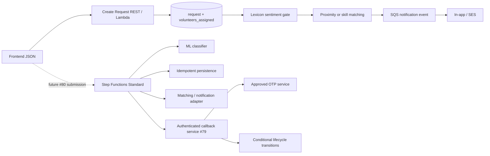
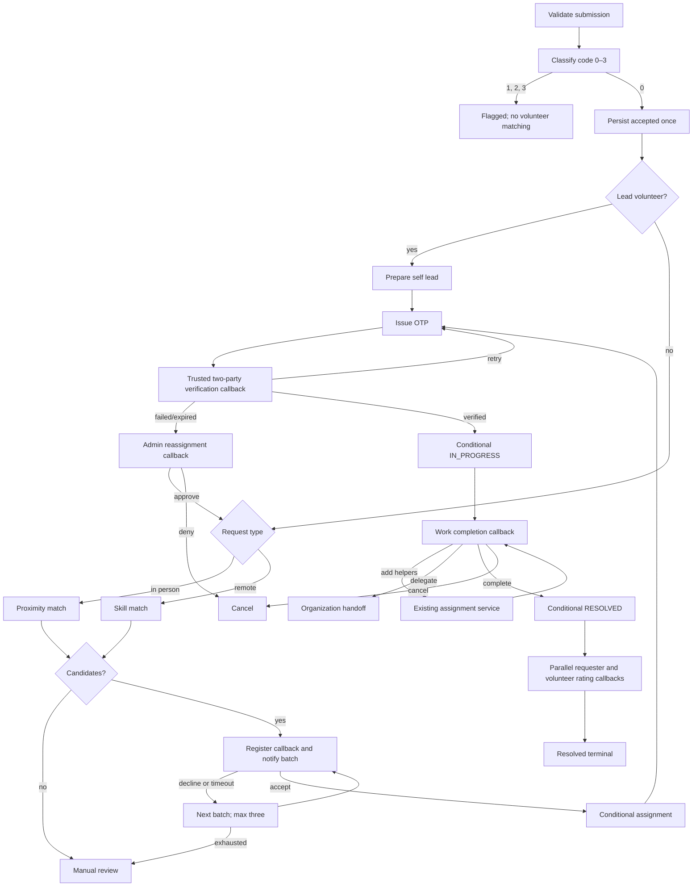

# Request lifecycle orchestration (Issue #88)

This directory contains a **reviewable, locally testable Standard Workflow contract**. The ASL is source controlled at [`src/main/resources/stepfunctions/request-workflow.asl.json`](../../src/main/resources/stepfunctions/request-workflow.asl.json). Read-only classification/matching and pure batch selection have Lambda handlers; the other task and callback integrations remain missing. The current Create Request endpoint does **not** start this workflow. Do not set `STEP_FUNCTIONS_ENABLED=true` in a shared environment until the prerequisites below are complete.

## Architecture and current boundary



The active path already persists a request, classifies it with a local lexicon, matches volunteers, and enqueues one notification event after commit. Running the new ASL alongside it would duplicate persistence and broadcasts. The new `WorkflowSubmissionAdapter` and `WorkflowExecutionStarter` are **opt-in components** kept separate from that path. The starter uses a SHA-256-derived Standard execution name from a stable submission ID. Identical open executions are idempotent at the Step Functions API; a closed execution name collision is surfaced as a conflict. A durable database idempotency/outbox record is still required before API wiring.

The adapter takes the agreed camelCase/nested frontend JSON and produces `{"submissionId":"...","requestData":{...}}`, preserving `additionalFields`. It fills `REMOTE(2)` when request type is omitted, matching current code, plus false calamity and zero lead defaults. The existing `RequestDTO` now deserializes `additionalFields` and no longer requires a client-supplied `requestStatus`, because `createRequest` assigns it server-side. The current service does **not** persist `additionalFields`; that remains a separate data contract. Current Java status IDs remain disputed under #78; no new production status writes were added.

`WorkflowReadTaskHandler` is a deployable Lambda entry point for the `classify`, `matchInPerson`, and `matchRemote` Task operations. It calls `WorkflowTaskAdapter`, which reuses the lexicon sentiment service and existing matching service. Match tasks verify the persisted requester, category, type, calamity flag, and matchable status against the ASL input before querying volunteers. Calamity matching fails closed until its policy is approved. It returns only a code or distinct volunteer IDs; email addresses never enter execution history. This is a **mock classifier** until AI #7 supplies the approved model interface. This handler has no persistence, notification, or status side effects.

## Workflow graph



Every Task has a timeout, bounded retry for Lambda service/client errors, and a controlled catch. Human waits use `.waitForTaskToken`; three volunteer notification batches are capped by the proposed policy in `database#226`, with one 24-hour acceptance window per batch. A fast decline waits until the next day; a timed-out window advances immediately. The implemented batch selector returns each candidate in at most one batch; the future notification service must still make delivery idempotent. The ASL itself cannot prevent a stale callback from racing with cancellation; the callback service must authenticate the actor and each lifecycle/assignment task must use a conditional database update that refuses `CANCELLED`, `DELETED`, or terminal rows. Cancel/delete must also call `StopExecution` using durable request-to-execution correlation.

## Task contracts and ownership

ASL uses JSONPath and optimized Lambda invocation. A normal Task response is read from `Payload`; callback output is the exact JSON passed to `SendTaskSuccess`. All Lambda invocations receive `operation` and `executionId`. Request content and task tokens must never be logged.

| ARN placeholder | Operations / required output | Intended owner and status |
|---|---|---|
| `ClassifierLambdaArn` | `classify(subject, description, submissionId)` → `{code:0|1|2|3}` | AI/Data ML #7; **Mocked** by `WorkflowReadTaskHandler` calling the local lexicon. Unknown/malformed code fails closed. |
| `PersistenceLambdaArn` | `persistAccepted(submissionId, requestData, classificationCode)` → `{requestId}` | Request #80; **Blocked**. Reuse `RequestServiceImpl.createRequest` only after extracting notification side effect and adding transactional idempotency. |
| `MatchingLambdaArn` | `matchInPerson` / `matchRemote` → `{hasCandidates, candidates}` | Request/spatial/volunteer; **Partial** via `WorkflowReadTaskHandler`. Existing queries are reused. Calamity exclusion and availability data are unverified. |
| `BatchLambdaArn` | `firstBatch` / `nextBatch` → `{exhausted, number, candidateIds}` | **Implemented for pure selection** by `WorkflowBatchTaskHandler`. It deduplicates the frozen match result, selects disjoint batches, validates the previous batch, and caps at three. `SAAYAM_WORKFLOW_BATCH_SIZE` is required; product/Database approval of its value and #226 policy remains blocked. Notification and response handling belong to #79. |
| `CallbackRegistrationLambdaArn` | `registerAcceptanceAndNotify`, `registerOtpCallback`, `registerAdminReassignment`, `registerWorkCallback`, `registerRatingCallback` | #79 for acceptance, admin, two ratings; OTP/work are additional required purposes. **Blocked**. Registration must persist encrypted token and recipient/purpose with uniqueness, then use existing SQS notifications; never send twice on retry. |
| `AssignmentLambdaArn` | `prepareSelfLead`, `confirmAssignment` → `{confirmed}`, `addHelpersIfActive` → result | Request #84; **Partial**. Use `volunteers_assigned` and conditional uniqueness. No second assignment table. |
| `OtpLambdaArn` | `issueOtp(requestId, assignment)` → `{challengeId}` | Approved OTP provider; **Blocked**. Return only opaque challenge ID. Store a keyed hash of codes, expiry, actor IDs and attempt count in an approved secure service; never raw OTP or code in SFN. |
| `LifecycleLambdaArn` | `markInProgressIfActiveAndVerified`, `resolveIfActive` → `{updated:true}` or `{terminal:true}`, `cancelIfActive` | Request #78; **Blocked** pending canonical status mapping and conditional update. Only trusted OTP service may attest `verified:true`. |
| `DelegationLambdaArn` | `delegateIfActive(requestId, organizationId)` → handoff confirmation | Organization integration; **Blocked**. |
| `ManualReviewLambdaArn` | `queueManualReview(requestId)` → `{queued:true}` | Steward/admin integration and new no-match status; **Blocked**. |

Callback outcomes: acceptance `{accepted:boolean,volunteerId?}`, OTP `{verified:boolean,attemptsRemaining:boolean}` from a server-side verifier, admin `{approved:boolean}`, work `{action:"ADD_HELPERS"|"DELEGATE"|"COMPLETE"|"CANCEL",volunteerIds?,organizationId?}`, rating `{recorded:boolean}`. The callback service must reject invalid, expired, wrong-recipient, and replayed tokens. Participant identity and OTP proofs are checked outside SFN. Rating outcomes are parallel and independent; they do not overwrite `RESOLVED`.

## Sample input and task output

The adapter receives the existing frontend JSON plus a stable submission ID supplied by the future #80 boundary. It emits this envelope (abridged):

```json
{
  "submissionId": "submission-12345678",
  "requestData": {
    "requesterId": "SID-00-000-000-000-000-100",
    "requestSubject": "AP Calculus AB Help",
    "requestDescription": "Need help with AP Calculus AB",
    "isCalamity": false,
    "isLeadVolunteer": 0,
    "requestType": {"requestTypeId": 2},
    "requestPriority": {"requestPriorityId": 1},
    "helpCategory": {"catId": "4.3.1"},
    "requestFor": {"requestForId": 0}
  }
}
```

For this accepted remote example, the classifier Task must return `{"code":0}`, the persistence Task `{"requestId":"REQ-100"}`, and the matching Task `{"hasCandidates":true,"candidates":["VOL-100"]}`. The optimized Lambda integration stores each under `Payload`; the acceptance callback returns `{"accepted":true,"volunteerId":"VOL-100"}` directly. A trusted OTP callback returns `{"verified":true}`. The lifecycle Task must return `{"updated":true}` before work starts. A final resolved execution retains its structured intermediate outputs and two independent rating outcomes; consumers should read the durable request/rating records rather than treating the execution output as the source of truth.

## Local testing without AWS

```bash
python3 docs/step-functions/build_definition.py
python3 -m unittest discover -s docs/step-functions -p test_workflow.py -v
```

`local_simulator.py` substitutes canned Lambda/callback outcomes and traverses Task, Choice, Wait, Parallel, Succeed and Fail states. It skips elapsed time and does **not** emulate AWS token persistence, IAM, transactionality, or execution history. The tests cover accepted/flagged, classifier error/timeout, in-person/remote, no-match, decline/acceptance timeout, invalid callback, OTP retry/failure, stale terminal guards, cancellation, resolution, and independent rating timeout.

For Java tests, use `mvn -Dtest=WorkflowSubmissionAdapterTest,WorkflowExecutionStarterTest,WorkflowTaskAdapterTest,WorkflowReadTaskHandlerTest,WorkflowBatchTaskHandlerTest test`. `WorkflowBatchTaskHandlerTest` invokes the actual Lambda handler contract for first/next/exhausted, deterministic retry, duplicate candidates, and malformed inputs. The checked-in `mvnw` has no executable bit, so use `sh mvnw ...` or installed Maven. Full `mvn test` still fails in the untouched `origin/dev` checkout at `RequestApplicationTests` because `spring.datasource.url` is not a JDBC URL without a configured datasource. This branch produces the same two environmental errors; no Maven configuration was changed to hide them. The project also lacks a Jakarta Validation provider, so `@Valid` behavior needs a separate dependency review before relying on it for submission validation.

The ASL was checked with `asl-validator@4.0.0` in a temporary directory:

```bash
npm install --prefix /tmp/issue-88-asl-validator asl-validator@4.0.0 --no-audit --no-fund
/tmp/issue-88-asl-validator/node_modules/.bin/asl-validator --json-path src/main/resources/stepfunctions/request-workflow.asl.json
```

Before deployment, render real per-environment Lambda ARNs by setting each placeholder-named environment variable and running `python3 docs/step-functions/render_definition.py --output /tmp/request-workflow.json`. The renderer rejects missing or non-Lambda ARNs. Then use `aws stepfunctions validate-state-machine-definition --type STANDARD --definition file:///tmp/request-workflow.json` in an authorized AWS environment. On 2026-10-28 AWS returned `result: OK` with zero diagnostics for the source ASL rendered with synthetic Lambda ARNs. This validates syntax, not the existence or behavior of any Lambda. The available account had zero Step Functions machines and zero Lambda functions in `us-east-1`, so no dev execution or deployment was possible.

## Deployment prerequisites and IAM

1. Resolve #78 status IDs against deployed RDS, reconcile the database seed, migrate any affected rows, and decide rating storage. The current database CSV maps 0 `CREATED`, 1 `MATCHING_VOLUNTEER`, 2 `IN_PROGRESS`, 3 `RESOLVED`, 4 `CANCELLED`, 5 `DELETED`, 6/7 rating states. Live RDS remains unverified. Do not ship status transitions that use the current offset Java enum.
2. Approve/deploy `database#157` bad-request storage and `database#226` no-match status/batch policy, plus reviewed execution/callback persistence. See [`schema-proposal.sql`](schema-proposal.sql). `ddl-auto=none` and `spring.sql.init.mode=never`; the Database repository owns DDL. No new entity here reads undeployed columns.
3. Implement approved AI classifier, secure OTP provider, #79 callback service (including OTP/work purposes), conditional status/assignment APIs, delegation and rating records. Reconcile volunteer availability, calamity exclusion, and spatial ownership. Validate complete 36-row spreadsheet contracts from #77 when obtainable.
4. Resolve #80 submission ownership: begin execution before persistence, have the persistence Task reuse request creation without its notification side effect, and define the HTTP accepted/pending response. Add durable submission idempotency and outbox/recovery for `StartExecution` failures. Keep old path as rollback until parity is demonstrated. The current flag only creates the opt-in beans; it does not switch API behavior.
5. Provision a **Standard** state machine and per-environment Lambda ARNs, encrypted execution history/log group with request text redacted or logging off, callback encryption key, SQS queue/DLQ, SES/SNS identities, CloudWatch alarms, and retention settings. [`dev-state-machine.yaml`](dev-state-machine.yaml) is a CloudFormation starting point for the Standard machine, least-privilege invocation role, and a deployable batch Lambda. It requires an S3-uploaded shaded jar, the source ASL JSON, nine other real Lambda ARNs, and a product-approved `BatchSize`. It deliberately does not create the missing services. `aws cloudformation validate-template --template-body file://docs/step-functions/dev-state-machine.yaml --region us-east-1` succeeded; no stack was deployed. A CI deploy pipeline is absent. Have DevSecOps review IAM and CI deployment ownership.

Environment reference: `STEP_FUNCTIONS_ENABLED` defaults to `false` and only creates the `SfnClient`/starter beans; it does not call them from Create Request. `STEP_FUNCTIONS_STATE_MACHINE_ARN` is required when enabled. `AWS_REGION` and optional `AWS_ENDPOINT_OVERRIDE` follow the existing AWS client configuration. The batch Lambda requires `SAAYAM_WORKFLOW_BATCH_SIZE` (1–100), with no default because the batch size is not approved. The definition renderer requires environment variables named exactly for each `${...}` ARN placeholder in the ASL; these are deployment inputs, not Spring runtime properties. Do not put real ARNs or secrets in source.

Least privilege: the state machine role needs `lambda:InvokeFunction` only for the listed function ARNs. The API role needs `states:StartExecution` for the specific machine; cancel/delete role needs `states:StopExecution` only for its execution ARN scope. The callback role needs `states:SendTaskSuccess`/`SendTaskFailure` and read/write access only to its token registry; the Lambda roles receive only their relevant database, SQS, KMS, and notification permissions. No public callback endpoint without authentication and actor authorization. No credentials, tokens or production ARNs are committed.

## Known limits

The ASL covers the **verified wiki branches**, not all spreadsheet rows. Transcription and category suggestion occur before the current Create Request API and have no verified backend contracts. Flagged submissions stop before persistence in this definition; bad-request storage and feedback are blocked. The batch selection Lambda is real code, but batch size and the three-window policy still need approval; notifications and durable acceptance callbacks are absent. The approved ML classifier, OTP, callback, lifecycle, delegation, and rating services are not implemented here. PR #92 provides name-based status handling but remains draft and unmerged, so this branch makes no new production status writes. The local path simulator tests control flow only. The feature is **not ready for AWS deployment or a production feature switch** until the above prerequisites are met.
